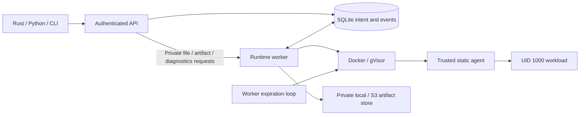

# API and worker

`goldenhoopd api` and `goldenhoopd worker` are separate processes sharing one private local SQLite database. The API authenticates requests and commits intent. Only the worker accesses Docker. It performs actual runtime probes, reconciliation, event collection and expiration independently of API availability. An OS file lock prevents two local workers from owning the same database.

Both HTTP services bind loopback. The public API requires a 32-512 byte opaque bearer token. Remote clients must reach a local TLS reverse proxy; a non-loopback API bind is refused. The worker uses a separate random credential stored only in the private database. Its private file endpoint rejects command and lifecycle methods. Workloads receive neither credential nor a daemon socket.

## Run locally

Build the trusted image and Rust binaries:

    docker build -f images/agent/Dockerfile -t goldenhoop-agent:local .
    cargo build --workspace

Start the worker and API in separate terminals using the same database path:

    goldenhoopd --database state/control.db worker --agent-image goldenhoop-agent:local
    goldenhoopd --database state/control.db api

Set `GOLDENHOOP_API_TOKEN` in the API's environment before starting it. Generate a random value with your secret manager or a cryptographic generator, for example `python -c "import secrets; print(secrets.token_urlsafe(32))"`. Do not embed a production token in a script, image or committed configuration. The agent/workload image must be cached locally. Add `--allow-runc-development` explicitly to the worker command only for the ordinary-container development profile.

## REST surface

All requests require `Authorization: Bearer <token>`. JSON DTO schemas are in spec/domain.openapi.json. Mutating lifecycle and command creation requests require `Idempotency-Key`, scoped to that resource/action. Replaying the same key returns the existing resource; different content returns Conflict. File replacement uses ordinary PUT semantics.

| Method | Path | Result |
| --- | --- | --- |
| GET | /healthz | Version, installation UUID and worker readiness |
| GET | /v1/profiles | Effective profiles after actual worker probes |
| POST | /v1/sandboxes | 202, sandbox and create operation |
| GET | /v1/sandboxes?after=UUID&limit=100 | Stable UUID-ordered page, limit 1-1000 |
| GET / DELETE | /v1/sandboxes/{id} | Sandbox / 202 termination operation |
| POST | /v1/sandboxes/{id}/pause or /resume | 202 operation |
| GET | /v1/sandboxes/{id}/diagnostics | Durable state, actual runtime flags and optional cgroup usage |
| POST | /v1/sandboxes/{id}/commands | 202 execution, literal argv |
| GET | /v1/executions/{id} | Current durable execution result |
| POST | /v1/executions/{id}/cancel | Persisted cancellation intent |
| GET | /v1/executions/{id}/events | Resumable SSE |
| GET | /v1/operations/{id} | Asynchronous operation result |
| PUT | /v1/sandboxes/{id}/files | Binary replacement: path and data_base64 |
| GET | /v1/sandboxes/{id}/files?path=...&max_bytes=... | Bounded base64 file content |
| DELETE | /v1/sandboxes/{id}/files?path=... | Remove a workspace file |
| GET | /v1/sandboxes/{id}/directories?path=... | Workspace directory entries |
| POST | /v1/sandboxes/{id}/artifacts | 202 retained artifact and capture operation |
| GET | /v1/artifacts?sandbox_id=UUID&after=UUID&limit=100 | Retained artifact metadata page |
| GET / DELETE | /v1/artifacts/{id} | Metadata / 202 deletion operation |
| GET | /v1/artifacts/{id}/content | Integrity-checked binary download |
| POST | /v1/sandboxes/{id}/sessions | 202 long-lived shell/process or PTY |
| GET | /v1/sessions | Session metadata page |
| GET | /v1/sessions/{id} | Session specification and execution |
| POST | /v1/sessions/{id}/controls | Queue ordered input control |
| GET | /v1/sessions/{id}/controls/{sequence} | Read delivery receipt |
| POST | /v1/sessions/{id}/cancel | Persist cancellation intent |
| GET | /v1/sessions/{id}/events | Resumable execution SSE |
| GET | /v1/sessions/{id}/socket?after=SEQUENCE | Authenticated duplex WebSocket |
| POST | /v1/sandboxes/{id}/code-contexts | 202 private interpreter context |
| GET | /v1/code-contexts?sandbox_id=UUID&after=UUID&limit=100 | Context metadata page |
| GET / DELETE | /v1/code-contexts/{id} | Context / 202 durable close intent |
| GET / POST | /v1/code-contexts/{id}/runs | Run page / 202 code run |
| GET | /v1/code-runs/{id} | Durable kernel run observation |
| POST | /v1/code-runs/{id}/cancel | Close the context and cancel queued work |
| GET | /v1/code-contexts/{id}/events | Durable context SSE with optional run IDs |

Typed errors distinguish invalid input, authentication, forbidden access, conflict/state, unsupported capabilities, quotas and unavailable backends. Public errors do not expose raw runtime payloads. Input decoding failures use the same error envelope.

Diagnostics use a separately authenticated private worker route; they never forward a workload-supplied RPC method. See [sampling and missing-data semantics](diagnostics.md).

Retained artifacts use a separate UUID-only private content route. Capture reads an authorized workspace file and prepares immutable length/digest before uploading. The storage credentials remain in the worker. Source expiration does not delete captured output; explicit artifact deletion is required. Configure the private local root or explicit S3 backend on the worker; see [configuration, recovery and cleanup](artifacts.md). Artifact create/delete requests also require Idempotency-Key.

Interactive sessions share execution IDs/events/cancellation. The API durably queues ordered controls and the worker reconciles delivery receipts before acknowledging them. A delivered input is not a code-success verdict. The same bearer authentication protects WebSocket upgrades; closing an observer does not cancel the session. See [session sequencing, limits and reconnect](sessions.md). Session create requires Idempotency-Key; controls use their sequence and content as their identity.

Code contexts are optional. Start the worker with `--kernel-probe-image <cached-image>` (or `GOLDENHOOP_KERNEL_PROBE_IMAGE`) to run an actual kernel gate per available runtime; the default worker leaves this capability disabled. There is no image pull or runtime/interpreter fallback. A positive probe verifies a selected administrator fixture, not that every requested workload image contains a kernel. Missing workload dependencies produce a failed context with confirmed collection. Context/run creation and context deletion require Idempotency-Key. Existing requests replay before worker freshness checks; close/cancel intent and historical reads work during worker downtime. See [context execution and collection](code-contexts.md).

Code-context event IDs use `context-UUID:sequence`. A run's `events_after` is its public context cursor at acceptance and remains unchanged on create-key replay. Use that cursor to collect a previous result without missing its completion. Context events include late/background provenance; output after a completed run does not change that result. Reads are capped at 256 events and 16 MiB per store batch, and at most 16 context SSE connections remain open per API instance. Disconnecting a stream does not cancel the interpreter. EOF cannot establish kernel success or context collection.

## Execution and recovery

API and worker restarts retain resource IDs, desired state, command IDs, results and event cursors. The worker recovers labeled runtime handles and does not recreate a sandbox that was previously observed running. A never-running create can be retried only after actual resource discovery/absence checks. Managed containers must not be externally restarted or modified; their restart policy does not restart exited workloads.

SSE event IDs have the form `execution-UUID:sequence`. Reconnect with `Last-Event-ID`, or use `?after=sequence`. Mismatched/ahead cursors are rejected. Stream disconnect does not cancel execution. Read a terminal execution result and matching completion event; stream EOF alone is insufficient. Output is binary-safe base64. The worker persists each batch before acknowledging it to the agent.

The worker escalates unconfirmed descendant cleanup to whole-sandbox termination. Cancellation gets a five-second observation window while the worker is available; inability to deliver/confirm it also triggers whole-sandbox termination. A runtime error leaves cleanup unconfirmed until actual removal is observed. This includes PID exhaustion that prevents launching a new RPC bridge. Expiration continues while paused and while the API is down; host/daemon availability and destruction latency affect final cleanup acknowledgement.

Worker heartbeat freshness is ten seconds. New operations requiring runtime support fail when it is stale. Read-only history and termination intent remain available through the API. The independent `goldenhoop-reaper` can additionally enforce expiration if the main worker is being maintained.

## Actual test

    python -B tests/api_contract.py --binary target/debug/goldenhoopd --runtime runc --work-dir .test-work --output evidence/api-runc.json

The suite launches separate services with a fresh installation and private random credentials. It exercises refusal, create/commands/files/events, stream resume, failures, timeout, cancellation, idempotency, real worker crashes, API restarts, paused expiration without the API, PID exhaustion, failed provisioning, diagnostics, retained artifacts and repeated deletion. Supplying the Rust client and CLI binaries also exercises four actual clients. The S3 option adds actual backend interruption and explicit committed/late-write fault injection. It removes its labeled containers and volumes, stops service processes, closes database/log handles and verifies temporary-directory removal. Failed cleanup is a failed test and retains a failure record rather than claiming a pass.

Supply `--kernel-image goldenhoop-kernel-fixture:test` after building `images/kernel/Dockerfile` to add six actual public-context groups. `--contexts-only` runs those groups independently for diagnosis; it does not count as the full API/client suite. CI runs the full suite with this option on both runtimes and the S3-compatible backend.

## Isolated child sandboxes

POST /v1/sandboxes/{parent}/isolated-sessions accepts CreateIsolatedSession and requires Idempotency-Key. The parent must have an available child reservation and accept new work throughout its ancestor chain. Child resources use the parent's runtime profile, a separate native sandbox and a deadline bounded by the parent. GET on that route pages direct children; GET /v1/sandboxes/{id}/scope returns the immutable hierarchy, reservation and logical allocation observations. History and stable request replay remain available after closure.

A separate actual two-runtime probe gates IsolatedSessions after the mandatory runtime baseline. Failure withholds that capability and logs a bounded reason; it does not choose another runtime. The host projects only each node's own workload hard limits to the native driver. Root reservation, child accounting and immutable callable-feature ceilings remain host responsibilities.

Commands, sessions/input controls, code contexts/runs, workspace files and artifact capture check ancestor state/deadline and feature ceilings before accepting or dispatching work. Diagnostics and retained artifact content check the corresponding immutable feature ceiling while preserving post-expiry observation/retention. Termination and cancellation remain available for collection. Parent pause/resume operations settle only after descendant observations match effective desire, retaining separately requested child pauses. Parent termination/expiry/confirmed unexpected loss closes descendants; Complete parent cleanup requires their confirmed collection. A lost parent's code results remain Unknown; a surviving descendant deliberately removed by cascade receives known cancellation after collection.

The five additional public test groups cover concurrent allocations and rollback, actual workload limits without double charging, workspace separation, feature/profile/network refusal, failed provisioning, four-edge hierarchy, inherited and own pause, real API/worker restart, stable replay, failure cascade without replacement and paused tree expiry while the API is offline. Use --isolated-only for these groups. Existing native isolation, context and four-client gates remain separate. See [allocation and lifetime details](isolated-sessions.md).
