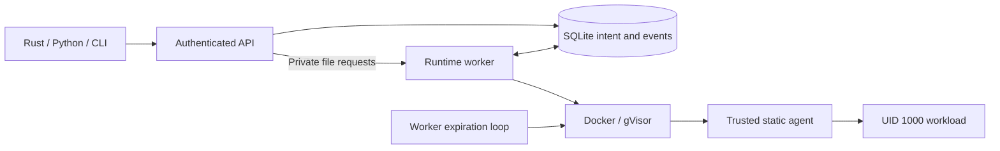

# API and worker

`goldenhoopd api` and `goldenhoopd worker` are separate processes sharing one private local SQLite database. The API authenticates requests and commits intent. Only the worker accesses Docker. It performs actual runtime probes, reconciliation, event collection and expiration independently of API availability. An OS file lock prevents two local workers from owning the same database.

Both HTTP services bind loopback. The public API requires a 32-512 byte opaque bearer token. Remote clients must reach a local TLS reverse proxy; a non-loopback API bind is refused. The worker uses a separate random credential stored only in the private database. Its private file endpoint rejects command and lifecycle methods. Workloads receive neither credential nor a daemon socket.

## Run locally

Build the trusted image and Rust binaries:

    docker build -f images/agent/Dockerfile -t goldenhoop-agent:local .
    cargo build --workspace

Start the worker and API in separate terminals using the same database path:

    goldenhoopd --database state/control.db worker --agent-image goldenhoop-agent:local
    goldenhoopd --database state/control.db api

Set `GOLDENHOOP_API_TOKEN` in the API's environment before starting it. Generate a random value with your secret manager or a cryptographic generator, for example `python -c "import secrets; print(secrets.token_urlsafe(32))"`. Do not embed a production token in a script, image or committed configuration. The agent/workload image must be cached locally. Add `--allow-runc-development` explicitly to the worker command only for the ordinary-container development profile.

## REST surface

All requests require `Authorization: Bearer <token>`. JSON DTO schemas are in spec/domain.openapi.json. Mutating lifecycle and command creation requests require `Idempotency-Key`, scoped to that resource/action. Replaying the same key returns the existing resource; different content returns Conflict. File replacement uses ordinary PUT semantics.

| Method | Path | Result |
| --- | --- | --- |
| GET | /healthz | Version, installation UUID and worker readiness |
| GET | /v1/profiles | Effective profiles after actual worker probes |
| POST | /v1/sandboxes | 202, sandbox and create operation |
| GET | /v1/sandboxes?after=UUID&limit=100 | Stable UUID-ordered page, limit 1-1000 |
| GET / DELETE | /v1/sandboxes/{id} | Sandbox / 202 termination operation |
| POST | /v1/sandboxes/{id}/pause or /resume | 202 operation |
| GET | /v1/sandboxes/{id}/diagnostics | Durable state, actual runtime flags and optional cgroup usage |
| POST | /v1/sandboxes/{id}/commands | 202 execution, literal argv |
| GET | /v1/executions/{id} | Current durable execution result |
| POST | /v1/executions/{id}/cancel | Persisted cancellation intent |
| GET | /v1/executions/{id}/events | Resumable SSE |
| GET | /v1/operations/{id} | Asynchronous operation result |
| PUT | /v1/sandboxes/{id}/files | Binary replacement: path and data_base64 |
| GET | /v1/sandboxes/{id}/files?path=...&max_bytes=... | Bounded base64 file content |
| DELETE | /v1/sandboxes/{id}/files?path=... | Remove a workspace file |
| GET | /v1/sandboxes/{id}/directories?path=... | Workspace directory entries |

Typed errors distinguish invalid input, authentication, forbidden access, conflict/state, unsupported capabilities, quotas and unavailable backends. Public errors do not expose raw runtime payloads. Input decoding failures use the same error envelope.

Diagnostics use a separately authenticated private worker route; they never forward a workload-supplied RPC method. See [sampling and missing-data semantics](diagnostics.md).

## Execution and recovery

API and worker restarts retain resource IDs, desired state, command IDs, results and event cursors. The worker recovers labeled runtime handles and does not recreate a sandbox that was previously observed running. A never-running create can be retried only after actual resource discovery/absence checks. Managed containers must not be externally restarted or modified; their restart policy does not restart exited workloads.

SSE event IDs have the form `execution-UUID:sequence`. Reconnect with `Last-Event-ID`, or use `?after=sequence`. Mismatched/ahead cursors are rejected. Stream disconnect does not cancel execution. Read a terminal execution result and matching completion event; stream EOF alone is insufficient. Output is binary-safe base64. The worker persists each batch before acknowledging it to the agent.

The worker escalates unconfirmed descendant cleanup to whole-sandbox termination. Cancellation gets a five-second observation window while the worker is available; inability to deliver/confirm it also triggers whole-sandbox termination. A runtime error leaves cleanup unconfirmed until actual removal is observed. This includes PID exhaustion that prevents launching a new RPC bridge. Expiration continues while paused and while the API is down; host/daemon availability and destruction latency affect final cleanup acknowledgement.

Worker heartbeat freshness is ten seconds. New operations requiring runtime support fail when it is stale. Read-only history and termination intent remain available through the API. The independent `goldenhoop-reaper` can additionally enforce expiration if the main worker is being maintained.

## Actual test

    python -B tests/api_contract.py --binary target/debug/goldenhoopd --runtime runc --work-dir .test-work --output evidence/api-runc.json

The suite launches separate services with a fresh installation and private random credentials. It exercises refusal, create/commands/files/events, stream resume, failures, timeout, cancellation, idempotency, real worker crashes, API restarts, paused expiration without the API, PID exhaustion, failed provisioning and repeated deletion. It removes its labeled containers and volumes, stops its service processes, closes database/log handles and verifies temporary-directory removal. Failed cleanup is a failed test, and retains a failure record rather than claiming a pass.
