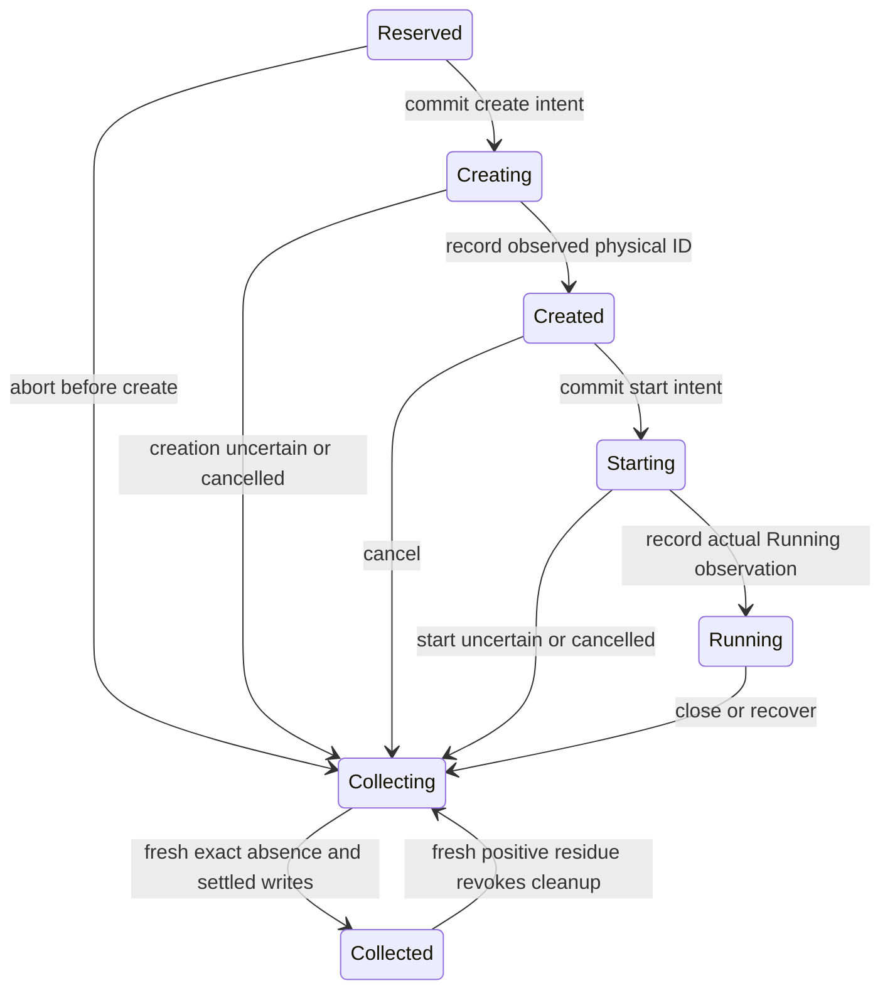

# Durable controller dispatch journal

Schema 8 records controller process epochs separately from network allocation generations. The Rust store now owns immutable plans and create/start/collection dispatch fences across service restarts. The production worker still needs to compose this journal with actual controller, endpoint, packet, DNS and workload reconciliation before advertising NetworkPolicy. Running process metadata grants no packet permission or lease.

Each record freezes installation/sandbox/network identity, the native bridge checkpoint and provider network ID, the original provisioning token, absolute sandbox expiry, pinned administrator image ID and a separate controller UUID. A new controller UUID gives a different physical name while retaining the same network ownership identity. Only one uncollected controller is permitted per sandbox. Physical container IDs cannot be reassigned to another epoch, including historical collected records. A deliberate new epoch requires confirmed old collection; reserving an old epoch returns its original state rather than resurrecting it.

Create and start each receive an independent token before external writes. Neither Creating nor Starting permits that action to be dispatched again. Recovery first loads the frozen image/plan from the database and positively inspects the provider. A matching ID may acknowledge creation; a container that appears Created cannot authorize replay when the journal already says Starting. Losing an acknowledgement does not reset the fence. Identical acknowledgements preserve revision/history, and late creation acknowledgement during collection records the ID without reactivating the process.

Every mutation uses an immediate SQLite transaction, revision comparison and an immutable event snapshot. Indexed identity/phase/revision columns must match the decoded payload. History reads are scoped and bounded; each sandbox has a 128-epoch history budget. New dispatch requires the original matching native allocation, a live absolute expiry and a Running desired state. Historical reads and collection remain available after expiry. Model/provider observations supplied to the store are trusted inputs, not observations made by the store itself.

Collection has a separate token and requires fresh matching provider absence with create/start writes settled. A dispatched creation without any positively recorded physical ID remains unknown even if a caller supplies an empty inventory. A reservation cancelled before create can finish without a physical ID. Controller process absence does not attest bridge, packet-table, endpoint or DNS absence. Beginning network collection atomically fences all uncollected controllers, and network/sandbox cleanup cannot complete while any controller remains uncollected.

A fresh positive observation after collection must match the original physical ID and be newer than its absence. It reopens controller collection. If network cleanup had completed, the same transaction revokes it, marks the sandbox Unknown with a Terminated desired state and retains reconciliation work. Old absence tokens or cached positive observations cannot revive a controller or complete the reopened cleanup. Kernel/provider observations in the file-backed residue tests are synthetic; those tests establish transaction/state behavior, not a native resurrection experiment.

The portable `ControllerPlan` lives in `goldenhoop-egress` and remains re-exported by the Docker provider. A missing process UUID is recognized only for historical inspection/collection; fresh create/start requires a non-nil process UUID. Original plan labels/names are preserved for historical collection. Schema 7 network payloads/history are not rewritten during migration, and existing sandbox/operation identities are retained.

The private real-backend contract now uses this actual file-database journal. Controlled exit 77 occurs after Docker creation is acknowledged but before the physical ID is committed; recovery records that original ID without creating again. Controlled exit 78 occurs after start intent is committed and before the start request; the next process refuses replay even though independent inspection still shows Created. After confirmed old process absence, a deliberate new epoch starts, binds the native bridge over private Rust stdio, exits successfully and is collected. Neither control is an injected Docker transport outage, and the contract publishes no workload or packet policy.

The [23-group actual contract](evidence/m3-network-native-controller-journal-provider-runc-windows-docker.json) passes with 121 matching source fingerprints, two collected process epochs and 13 immutable event snapshots. The [21-group actual API/client regression](evidence/m3-network-native-controller-journal-api-runc-windows-docker.json) also passes. [Windows gates](evidence/m3-network-native-controller-journal-validation-windows.json) pass strict format/clippy, 169 tests and all binary/example builds. [Linux gates](evidence/m3-network-native-controller-journal-linux-build.json) pass strict checks, 186 tests and both musl executables. Seven new file-database groups use synthetic provider/kernel observations; a separate portable group verifies historical plans cannot authorize dispatch.

The [initial Windows full attempt](evidence/m3-network-native-controller-journal-validation-initial-windows.json) remains failed at the existing DNS paired-port fixture, before that case's protocol assertions. Its original candidate addresses were not captured. [Read-only diagnostics](evidence/m3-network-native-controller-journal-dns-fixture-windows.json) retain current differing TCP/UDP exclusion ranges and a later successful old-algorithm probe; they do not claim to reproduce the original allocation sequence. The fixture now samples distinct high loopback ports and requires both real binds. All nine DNS cases and the final complete gates pass. The [earlier Linux build](evidence/m3-network-native-controller-journal-linux-initial-build.json) passed before this test-only correction and is preserved separately.

[Final scoped cleanup](evidence/m3-network-native-controller-journal-cleanup-windows.json) verifies six provider/API inventories empty, both controller instances collected, the native bridge and four table scopes absent, temporary state/audit collection and disposable/superseded image absence. Source, evidence, useful caches/tools and the exact current trusted agent remain. Full M0-M6 and production worker/network composition remain active requirements.
