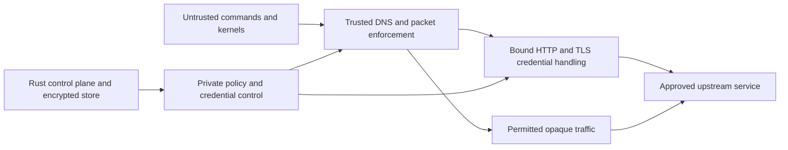

# M3 enforcement and acceptance contract

Status: planned. Current production profiles still provide default-deny network isolation and refuse nondefault network policies. No dynamic-policy, credential-broker or scoped-key capability is established by this document. M2's expanded runtime gates remain a separate prerequisite.

The accepted scope includes transparent DNS/packet enforcement, live policy changes, destination/method/path-bound credentials, scoped/revocable API keys and durable redacted audit. API/SDK wire compatibility with OpenSandbox is not required; existing implemented reference behavior remains part of the coverage audit. The pinned reference describes [DNS plus packet enforcement](https://github.com/opensandbox-group/OpenSandbox/blob/8af823ed83f71209772d334df73626f90dd72496/docs/architecture/network/egress.md), [credential bindings and exchange](https://github.com/opensandbox-group/OpenSandbox/blob/8af823ed83f71209772d334df73626f90dd72496/docs/guides/credential-vault.md) and [transparent TLS handling](https://github.com/opensandbox-group/OpenSandbox/blob/8af823ed83f71209772d334df73626f90dd72496/components/egress/docs/mitmproxy-transparent.md). A proxy environment variable alone does not meet packet-layer acceptance.

## Execution boundary

The workload receives no provider credential, API management key, daemon socket or private CA key. Public CA material may be delivered for explicitly enabled TLS interception. Untrusted processes receive no network-administration capability. Enforcement and privileged setup live in trusted runtime components outside workload control. The concrete Docker/gVisor datapath must be proven before advertising support; host or network-stack fallback is not an acceptable substitute.

A sandbox's egress identity is bound to its installation, sandbox UUID and actual runtime resources. An untrusted request header cannot select another sandbox or policy. Trusted control endpoints use private authenticated channels. Data-plane resources have ownership records and bounded lifetimes, with actual absence required for collection. Child policy is constrained by every ancestor and immutable feature ceiling.

### Datapath candidate to prove

One candidate places the trusted Rust DNS/TLS broker and a firewall manager in the Docker engine's Linux network namespace. Each sandbox gets its own owned bridge; independent nftables bridge/inet tables enforce source identity, host-input restrictions, redirection and forwarding. This would observe packets after they leave a runtime, including gVisor's user-space network stack. It is a design hypothesis, not an established backend. No Docker-owned rule, daemon firewall setting or unrelated bridge may be changed. Docker documents its [firewall integration](https://docs.docker.com/engine/network/packet-filtering-firewalls/); nftables documents distinct [bridge input and forwarding paths](https://wiki.nftables.org/wiki-nftables/index.php/Bridge_filtering).

The prototype must prove endpoint identity before workload start, fail-closed quarantine before network publication, atomic rule transactions, IPv4/IPv6 and Ethernet coverage, and restart/removal behavior. It must explicitly exercise Docker's embedded loopback resolver, DNS over TCP/UDP, raw destination addresses, host-gateway and same-bridge traffic. A filter only on host OUTPUT or only on routed FORWARD traffic does not by itself meet this matrix. Unsupported host privilege/kernel configurations must refuse the feature.

The manager's API and generated commands must accept only journal-bound installation/network/runtime identities, tables and allocation generations. Host NET_ADMIN is broad kernel authority, so this manager remains a trusted host component; naming/validation does not create a kernel restriction to its own tables. The prototype must show that manager/broker loss leaves a known deny boundary or causes sandbox quarantine, and that replacement cannot adopt an unrelated table with the same name. No provider secret or manager socket is mounted in a workload. Additional trusted-service resource overhead needs an explicit budget and actual observations. The final datapath is chosen only after independent runc and gVisor boundary tests pass.

The initial [host preflight](evidence/m3-netfilter-capabilities-windows-docker.json) reports bridge-family rejection on Docker Desktop's Linux kernel. Its container and image are collected. The explicitly [inet-only check](evidence/m3-netfilter-inet-capabilities-windows-docker.json) confirms that separate primitive under only NET_ADMIN and no-new-privileges; it does not establish bridge filtering or any packet policy. The independent Network prerequisites CI requires both families on Linux. A successful `nft --check` is a kernel prerequisite observation, not an egress enforcement pass.

The [first IPv4 routed-filter mechanism gate](evidence/m3-ipv4-routed-prototype-owned-runc-windows-docker.json) passes five groups locally on runc. An owned private bridge is quarantined before an unprivileged workload starts; host-input and routed-forward filters live in independent tables outside that workload. Owned live TCP/UDP services provide nonce-echo positive controls. Exact destination/TCP-port admission, denied other ports/UDP/host input and packet denial on a previously usable connection are observed with kernel counters. The fixture uses Docker's [routed gateway mode](https://docs.docker.com/engine/network/port-publishing/#gateway-modes) for its receiver; Desktop also reports loopback-only host bindings, which are recorded. Workload probes use the receiver IP directly and must traverse the scoped forwarding rules.

This fixture has no production API/driver integration and does not verify DNS, IPv6, same-bridge Ethernet traffic, TLS/credentials, socket/conntrack collection or durable policy revisions. It grants no capability. The next Linux matrix runs the mechanism independently under runc and gVisor. Rule ownership is verified by the exact table marker; nft 1.0.6's JSON listing omits that table comment, so the prototype checks its native table-level listing. An earlier attempt correctly remained cleanup-unknown when this validation failed; [recovery evidence](evidence/m3-ipv4-routed-prototype-recovered-cleanup-windows.json) records the observed marker/interface identity and confirmed table/network/container/image removal. The original failed report is preserved.

## Policy and observed revisions

Network decisions cover domain/wildcard targets, IPs/CIDRs and bounded TCP destination ports. DNS names and addresses require canonical validation, including trailing dots, case, IDNA, IPv4-mapped IPv6 and scoped-address handling. Raw IP, alternate DNS, IPv6 and UDP/QUIC cannot bypass the selected policy. Protected control-plane, host and metadata endpoints need operator-owned restrictions independent of a user allow rule. Policy precedence and any operator allow/deny/port floors must be explicit.

DNS-derived grants have bounded leases. A DNS answer cannot grant access before the packet layer confirms installation; failed installation returns a resolution failure. Overlapping domain/address grants must not allow a different source domain to renew a revoked grant indefinitely. IP-based authorization is an endpoint permission; it does not independently prove an HTTP virtual-host identity.

Desired revision and observed applied revision are separate durable states. Tightening, credential changes and revocation acknowledge only after affected flows are collected or reach an explicitly bounded drain condition. Failed publication keeps a known enforced revision or quarantines the sandbox. Unknown enforcement is not success. Recovery reconciles actual rule/connection/broker identity and never trusts a guest claim of installation. An update must not be silently weakened after worker/API restart.

## Credentials and authentication

Credential handling binds the canonical scheme, host, port, method and path before obtaining or injecting a secret. Exactly one binding must match. Redirects, connection reuse, HTTP authority/SNI disagreement, encoded-path ambiguity and shared-IP destinations cannot move a secret to another origin. Ordinary opaque TLS permission and credential authorization are distinct decisions.

The reference coverage audit includes bearer/basic/API-key/custom-header injection, configured placeholder substitutions and host-side exchange resolution. Chained upstream proxy authentication, when supported, stays in the trusted component. All supported HTTP versions and stream behaviors need actual tests; unsupported modes must be refused explicitly.

Exchange results are admitted only if the binding and policy decision identities remain current after the asynchronous resolver call. Credential rotation/revocation has observable convergence. Uncertain resolver/upstream delivery is not retried as if it were unsent. Vault reads, errors, audit and response headers expose no secret value. Approved credential upstreams are trusted recipients; response handling must have an explicit redaction and streaming contract.

Secrets are encrypted at rest under a private host master key, with fresh nonces, authenticated identity/version metadata and bounded zeroized plaintext lifetimes. Credential idempotency fingerprints must not create an unkeyed dictionary oracle for low-entropy values. Private key and secret material never enter a workload image, mount, environment, connection file or artifact.

API keys have high-entropy secret material, stored verification digests, bounded scope/resource/expiry constraints and explicit revocation. Authentication applies to every operation, retained read, SSE continuation and WebSocket control. Revoked long-lived sessions terminate within a measured bound. Bootstrap administration remains a separate host-controlled authority; callers cannot mint a broader key than their own grant.

Audit records preserve actor/key ID, target, request/operation identity, policy/binding revision and actual outcome. Acceptance, dispatch, HTTP observation, interpreter success and confirmed collection remain distinct. Audit is durable and ordered, with redacted inputs and no provider/header/token value or substituted secret URL. A local hash chain alone is not an independent tamper-proof guarantee.

## Actual acceptance matrix

| Input and task | Required observation | Failure condition |
| --- | --- | --- |
| Default policy; direct TCP/IP, DNS, IPv6, UDP and QUIC attempts | Denial outside workload control, with an actual allowed control where applicable | Process launch, timeout or a parser-only result substituted for enforcement |
| Domain/CIDR/wildcard and port rules; mixed canonical forms | Exact effective rule precedence and destination coverage | Rebinding, alternate DNS or address normalization broadens access |
| DNS answer whose packet-install callback fails | No successful address grant; previous policy remains known | Answer published before installation or an unbounded address lease |
| Established flows while tightening or revoking | Applied revision plus actual flow collection/drain evidence | Revision acknowledged while a revoked flow remains usable |
| API/worker/broker interruption during publication | Known enforced generation or quarantine; recoverable identities | Guest or stale local metadata establishes applied success |
| Bound TLS requests plus host/path/method/redirect variants | Secret appears only at the approved upstream; denied variants do not receive it | Origin confusion, ambiguous match or secret in guest-visible headers/logs |
| Credential rotation and delayed exchange response | Current generation is rechecked; old grants cannot regain authority | Late resolver result restores revoked credentials |
| Scoped and revoked keys, including active SSE/WS | Per-operation denial and measured session termination | Old stream/control bypasses revocation |
| Parent/child policy, pause, expiry and loss | Effective ancestor restrictions and recursive resource collection | Child broadens authority or a detached process retains revoked egress |
| Failure before/after resource creation; repeated delete | Owned network/rule/broker resources confirmed absent | A successful request or delete acknowledgement is counted as cleanup |

Each runtime gate records versions, resource limits, policy generations, actual wire/service observations, expected denials, timing bounds and scoped cleanup. Unit/model tests precede those gates and remain a separate evidence category. Missing kernel features, privileges or hardware leave the corresponding profile unverified.
