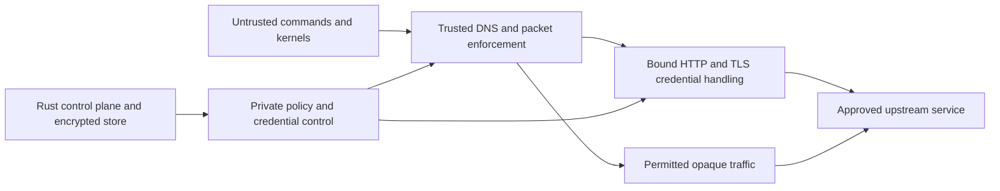

# M3 enforcement and acceptance contract

Status: M3 is in progress. The Rust compiler, trusted DNS/packet enforcement, staged worker orchestration and public policy updates have actual runc/gVisor acceptance. Existing profiles retain none-network isolation without administrator network configuration. Both automatic public protected creation gates at 41ab2d0 fail their actual deployment probe; this path and hierarchy remain unaccepted. Credentials, scoped keys and audit remain incomplete/unverified. M2 acceptance is complete at e96da9f.

The accepted scope includes transparent DNS/packet enforcement, live policy changes, destination/method/path-bound credentials, scoped/revocable API keys and durable redacted audit. API/SDK wire compatibility with OpenSandbox is not required; existing implemented reference behavior remains part of the coverage audit. The pinned reference describes [DNS plus packet enforcement](https://github.com/opensandbox-group/OpenSandbox/blob/8af823ed83f71209772d334df73626f90dd72496/docs/architecture/network/egress.md), [credential bindings and exchange](https://github.com/opensandbox-group/OpenSandbox/blob/8af823ed83f71209772d334df73626f90dd72496/docs/guides/credential-vault.md) and [transparent TLS handling](https://github.com/opensandbox-group/OpenSandbox/blob/8af823ed83f71209772d334df73626f90dd72496/components/egress/docs/mitmproxy-transparent.md). A proxy environment variable alone does not meet packet-layer acceptance.

## Execution boundary



The workload receives no provider credential, API management key, daemon socket or private CA key. Public CA material may be delivered for explicitly enabled TLS interception. Untrusted processes receive no network-administration capability. Enforcement and privileged setup live in trusted runtime components outside workload control. The concrete Docker/gVisor datapath must be proven before advertising support; host or network-stack fallback is not an acceptable substitute.

A sandbox's egress identity is bound to its installation, sandbox UUID and actual runtime resources. An untrusted request header cannot select another sandbox or policy. Trusted control endpoints use private authenticated channels. Data-plane resources have ownership records and bounded lifetimes, with actual absence required for collection. Child policy is constrained by every ancestor and immutable feature ceiling.

### Datapath candidate to prove

One candidate places the trusted Rust DNS/TLS broker and a firewall manager in the Docker engine's Linux network namespace. Each sandbox gets its own owned bridge; independent nftables bridge/inet tables enforce source identity, host-input restrictions, redirection and forwarding. This would observe packets after they leave a runtime, including gVisor's user-space network stack. It is a design hypothesis, not an established backend. No Docker-owned rule, daemon firewall setting or unrelated bridge may be changed. Docker documents its [firewall integration](https://docs.docker.com/engine/network/packet-filtering-firewalls/); nftables documents distinct [bridge input and forwarding paths](https://wiki.nftables.org/wiki-nftables/index.php/Bridge_filtering).

The prototype must prove endpoint identity before workload start, fail-closed quarantine before network publication, atomic rule transactions, IPv4/IPv6 and Ethernet coverage, and restart/removal behavior. It must explicitly exercise Docker's embedded loopback resolver, DNS over TCP/UDP, raw destination addresses, host-gateway and same-bridge traffic. A filter only on host OUTPUT or only on routed FORWARD traffic does not by itself meet this matrix. Unsupported host privilege/kernel configurations must refuse the feature.

The manager's API and generated commands must accept only journal-bound installation/network/runtime identities, tables and allocation generations. Host NET_ADMIN is broad kernel authority, so this manager remains a trusted host component; naming/validation does not create a kernel restriction to its own tables. The prototype must show that manager/broker loss leaves a known deny boundary or causes sandbox quarantine, and that replacement cannot adopt an unrelated table with the same name. No provider secret or manager socket is mounted in a workload. Additional trusted-service resource overhead needs an explicit budget and actual observations. The final datapath is chosen only after independent runc and gVisor boundary tests pass.

The initial [host preflight](evidence/m3-netfilter-capabilities-windows-docker.json) reports bridge-family rejection on Docker Desktop's Linux kernel. Its container and image are collected. The explicitly [inet-only check](evidence/m3-netfilter-inet-capabilities-windows-docker.json) confirms that separate primitive under only NET_ADMIN and no-new-privileges; it does not establish bridge filtering or any packet policy. The independent Network prerequisites CI requires both families on Linux. A successful `nft --check` is a kernel prerequisite observation, not an egress enforcement pass.

The [first IPv4 routed-filter mechanism gate](evidence/m3-ipv4-routed-prototype-owned-runc-windows-docker.json) passes five groups locally on runc. An owned private bridge is quarantined before an unprivileged workload starts; host-input and routed-forward filters live in independent tables outside that workload. Owned live TCP/UDP services provide nonce-echo positive controls. Exact destination/TCP-port admission, denied other ports/UDP/host input and packet denial on a previously usable connection are observed with kernel counters. The fixture uses Docker's [routed gateway mode](https://docs.docker.com/engine/network/port-publishing/#gateway-modes) for its receiver; Desktop also reports loopback-only host bindings, which are recorded. Workload probes use the receiver IP directly and must traverse the scoped forwarding rules.

This fixture has no production API/driver integration and does not verify DNS, IPv6, same-bridge Ethernet traffic, TLS/credentials, socket/conntrack collection or durable policy revisions. It grants no capability. The initial Linux matrix fails positive TCP admission on both runtimes while host controls remain live. The next fixture revision explicitly requests routed-only publication using the documented unspecified bind address, requires empty host ports, and captures the actual filter/host-routing state on failure only in ephemeral CI. Local Desktop tests keep loopback-only publication. No Docker-owned rule or global daemon setting is changed. Rule ownership is verified by the exact table marker; nft 1.0.6's JSON listing omits that table comment, so the prototype checks its native table-level listing. An earlier attempt correctly remained cleanup-unknown when this validation failed; [recovery evidence](evidence/m3-ipv4-routed-prototype-recovered-cleanup-windows.json) records the observed marker/interface identity and confirmed table/network/container/image removal. The original failed report is preserved.

## Policy and observed revisions

The Rust `goldenhoop-policy` compiler validates syntax independently of a data plane. It bounds a policy to 256 rules and each raw port list to 256 entries, rejects port zero, and canonicalizes/deduplicates valid ports. Targets are exact domains, `*.domain` subdomains, strict IP literals, network-address CIDRs or `*` (including port-only rules). Nonempty ports qualify TCP and are accepted only for IP/CIDR/`*` targets; domain-plus-port rules are refused. Input DTOs and idempotency specifications are retained separately from compiled values.

Domain handling applies IDNA plus DNS/LDH length/label checks, a single root dot and complete wildcard label boundaries. It retains valid CDN-style hyphens, while rejecting URI/control/whitespace syntax and ambiguous numeric-host forms. IPv4-mapped IPv6 addresses and qualifying mapped CIDRs become IPv4 targets; scoped/bracketed addresses, invalid prefixes and CIDRs containing host bits are refused. Public errors contain no supplied target value. Core admission still requires a probed NetworkPolicy capability before accepting any nondefault network request. Compilation does not resolve a name, associate it with an IP, install a rule, authorize a flow or obtain a credential. Those trusted associations and actual enforcement remain separate acceptance requirements.

Network decisions cover domain/wildcard targets, IPs/CIDRs and bounded TCP destination ports. DNS names and addresses require canonical validation, including trailing dots, case, IDNA, IPv4-mapped IPv6 and scoped-address handling. Raw IP, alternate DNS, IPv6 and UDP/QUIC cannot bypass the selected policy. Protected control-plane, host and metadata endpoints need operator-owned restrictions independent of a user allow rule. Policy precedence and any operator allow/deny/port floors must be explicit.

DNS-derived grants have bounded leases. A DNS answer cannot grant access before the packet layer confirms installation; failed installation returns a resolution failure. Overlapping domain/address grants must not allow a different source domain to renew a revoked grant indefinitely. IP-based authorization is an endpoint permission; it does not independently prove an HTTP virtual-host identity.

Desired revision and observed applied revision are separate durable states. Tightening, credential changes and revocation acknowledge only after affected flows are collected or reach an explicitly bounded drain condition. Failed publication keeps a known enforced revision or quarantines the sandbox. Unknown enforcement is not success. Recovery reconciles actual rule/connection/broker identity and never trusts a guest claim of installation. An update must not be silently weakened after worker/API restart.

## Credentials and authentication

Credential handling binds the canonical scheme, host, port, method and path before obtaining or injecting a secret. Exactly one binding must match. Redirects, connection reuse, HTTP authority/SNI disagreement, encoded-path ambiguity and shared-IP destinations cannot move a secret to another origin. Ordinary opaque TLS permission and credential authorization are distinct decisions.

The reference coverage audit includes bearer/basic/API-key/custom-header injection, configured placeholder substitutions and host-side exchange resolution. Chained upstream proxy authentication, when supported, stays in the trusted component. All supported HTTP versions and stream behaviors need actual tests; unsupported modes must be refused explicitly.

Exchange results are admitted only if the binding and policy decision identities remain current after the asynchronous resolver call. Credential rotation/revocation has observable convergence. Uncertain resolver/upstream delivery is not retried as if it were unsent. Vault reads, errors, audit and response headers expose no secret value. Approved credential upstreams are trusted recipients; response handling must have an explicit redaction and streaming contract.

Secrets are encrypted at rest under a private host master key, with fresh nonces, authenticated identity/version metadata and bounded zeroized plaintext lifetimes. Credential idempotency fingerprints must not create an unkeyed dictionary oracle for low-entropy values. Private key and secret material never enter a workload image, mount, environment, connection file or artifact.

API keys have high-entropy secret material, stored verification digests, bounded scope/resource/expiry constraints and explicit revocation. Authentication applies to every operation, retained read, SSE continuation and WebSocket control. Revoked long-lived sessions terminate within a measured bound. Bootstrap administration remains a separate host-controlled authority; callers cannot mint a broader key than their own grant.

Audit records preserve actor/key ID, target, request/operation identity, policy/binding revision and actual outcome. Acceptance, dispatch, HTTP observation, interpreter success and confirmed collection remain distinct. Audit is durable and ordered, with redacted inputs and no provider/header/token value or substituted secret URL. A local hash chain alone is not an independent tamper-proof guarantee.

## Actual acceptance matrix

| Input and task | Required observation | Failure condition |
| --- | --- | --- |
| Default policy; direct TCP/IP, DNS, IPv6, UDP and QUIC attempts | Denial outside workload control, with an actual allowed control where applicable | Process launch, timeout or a parser-only result substituted for enforcement |
| Domain/CIDR/wildcard and port rules; mixed canonical forms | Exact effective rule precedence and destination coverage | Rebinding, alternate DNS or address normalization broadens access |
| DNS answer whose packet-install callback fails | No successful address grant; previous policy remains known | Answer published before installation or an unbounded address lease |
| Established flows while tightening or revoking | Applied revision plus actual flow collection/drain evidence | Revision acknowledged while a revoked flow remains usable |
| API/worker/broker interruption during publication | Known enforced generation or quarantine; recoverable identities | Guest or stale local metadata establishes applied success |
| Bound TLS requests plus host/path/method/redirect variants | Secret appears only at the approved upstream; denied variants do not receive it | Origin confusion, ambiguous match or secret in guest-visible headers/logs |
| Credential rotation and delayed exchange response | Current generation is rechecked; old grants cannot regain authority | Late resolver result restores revoked credentials |
| Scoped and revoked keys, including active SSE/WS | Per-operation denial and measured session termination | Old stream/control bypasses revocation |
| Parent/child policy, pause, expiry and loss | Effective ancestor restrictions and recursive resource collection | Child broadens authority or a detached process retains revoked egress |
| Failure before/after resource creation; repeated delete | Owned network/rule/broker resources confirmed absent | A successful request or delete acknowledgement is counted as cleanup |

Each runtime gate records versions, resource limits, policy generations, actual wire/service observations, expected denials, timing bounds and scoped cleanup. Unit/model tests precede those gates and remain a separate evidence category. Missing kernel features, privileges or hardware leave the corresponding profile unverified.

## Routed return-path observation

The next [Linux matrix](evidence/ci-45468753824/network-ipv4-runsc/network-ipv4-runsc.json) still denies its positive TCP control after correctly admitting both SYN attempts through the owned forward rule. Its captured Docker raw PREROUTING rule drops packets addressed directly to the unpublished guest IP from another interface. With guest masquerading disabled, receiver replies target that guest IP and meet the raw drop before connection tracking. The prototype now uses standard Docker masquerading on its owned guest bridge. Scoped admission runs before POSTROUTING source NAT; default denial, exact TCP qualification and host-input restrictions stay in the owned chains. No Docker-owned rule or daemon setting is edited. The [five-group local NAT prototype](evidence/m3-ipv4-nat-return-prototype-runc-windows-docker.json) passes, with table/container/network/image collection confirmed. Linux runc/gVisor retesting remains necessary, and this is still not production NetworkPolicy support.

## Candidate decision model

`goldenhoop-policy::Model` computes DNS-name and static-address candidates separately. It validates transport shape, intersects one to five user layers, applies user denies before allows, and places trusted operator deny/allow overlays above user policy. The optional TCP port cap precedes all address allows; missing or empty caps impose no floor, matching the pinned reference. Port-bearing rules match TCP only and cannot authorize DNS. Domain rules cannot authorize a raw address. A candidate allow is not a DNS-source lease, installed firewall permission or runtime capability. Operator overlays must never be populated from caller policy.

Commit 9d906f7 passes the [actual Linux network matrix](https://github.com/mark0-cn/GoldenHoop/actions/runs/45470672320). [runc](evidence/ci-45470672320/network-ipv4-runc/network-ipv4-runc.json) and [gVisor](evidence/ci-45470672320/network-ipv4-runsc/network-ipv4-runsc.json) each pass five IPv4 mechanism groups using routed receiver publication, with no host ports and confirmed scoped cleanup. Every recorded fixture source hash matches that immutable commit. DNS, IPv6, Ethernet, production policy acknowledgements and credentials still need implementation and actual tests.

## Rust host adapter increment

`goldenhoop-egress` runs on Linux under only NET_ADMIN and no-new-privileges, with a trusted root-owned nft executable. It accepts bounded JSON-line control on private stdio. The caller is the trusted allocation controller; this interface must never be reachable from a workload or public API. Allocation records contain installation/sandbox/generation UUIDs, a restricted bridge name and its actual ifindex. The allocator must verify Docker ownership, journal the allocation and assign the derived bridge alias before installation. Current API/driver integration does not perform these steps yet.

The adapter verifies alias/ifindex/bridge identity, uses allocation-bound owner and revision chains, and takes an abstract Unix namespace lock shared by host-network containers. A fresh install is quarantine. Policy replacement uses one nft transaction and acknowledges only after reading the owned kernel table at the expected new revision. Control changes use expected revisions; malformed or unsupported domain policies refuse before mutation. Operator deny precedes operator allow, which precedes the intersection of user layers; the TCP cap precedes every TCP allow. Static IPv6 syntax compiles but actual IPv6 and Ethernet boundaries remain unverified.

Each permission also requires membership in a ten-second kernel timeout set. Confirmed leases can be renewed only by the current controller. EOF or controller death does not remove the deny boundary; without renewal the kernel stops admitting new and established packets. A restarted controller can observe the table but must confirm quarantine before applying or renewing permissions. An uncertain mutation cannot be renewed or followed by another allow; explicit observed-revision quarantine is required. These are process-local safety states, not a durable policy journal. Final table deletion requires the bridge to be absent and then confirms the table is absent.

Build the trusted image with `docker build --target host-egress -f images/agent/Dockerfile -t goldenhoop-egress:test .`. The default agent target does not contain the host controller. The public network fixture copies the controller for independent traffic tests; its workload still has UID 1000, no capabilities and no-new-privileges. The [13-group local runc gate](evidence/m3-rust-host-adapter-runc-windows-docker.json) includes real positive services, hierarchy/CIDR/port and operator precedence, allocation/lock/stale-revision refusals, controller-loss expiry, restart quarantine, independent tightening and confirmed collection. The [initial failure](evidence/m3-rust-host-adapter-initial-runc-windows-docker.json) preserves a fixture error: reusing a socket already timed out by the lease could not prove a second tightening event. The corrected oracle establishes a fresh working connection first. The initial attempt also collected its resources.

This adapter is a partial trusted component, with no production NetworkPolicy grant. DNS source leases, resolver redirection, Docker embedded DNS, IPv6/L2 enforcement, connection preservation/revocation modes, durable revisions, credential interception, key scopes and redacted audit still require implementation and actual backend gates.

## DNS wire and upstream increment

The DNS library uses [Hickory proto 0.26.4](https://github.com/hickory-dns/hickory-dns/releases/tag/v0.26.4), pinned with only its std codec feature. It bounds wire lengths and section counts before decoding, requires one IN A/AAAA question, checks the name against the candidate policy, rebuilds a sanitized upstream query and uses an independent random transaction ID. Other question types currently refuse. No DNSSEC validation is claimed; AD/CD and arbitrary EDNS options are not forwarded.

A fixed numeric upstream uses a connected ephemeral UDP socket. Malformed or wrong-ID replies are ignored within bounded attempts and one three-second transport deadline. A matching truncated reply retries TCP at the same endpoint; incomplete TCP framing/EOF never supplies an answer. Reply validation checks question/ID/class, one connected CNAME chain, record/address limits and TTL. Unrelated answer records and loops refuse; authority and additional data cannot become address grants. The source credit names the original question, with a unique lookup ID and policy revision, and expires within the smallest connected TTL capped at 300 seconds.

`PendingAnswer::finish` awaits a trusted installer and requires a matching lookup ID/revision and an unextended, unexpired receipt before encoding address records. Its acknowledgement deadline is bounded by the source expiry and three seconds. It rechecks expiry after encoding, clamps returned TTLs, and emits an address-free truncated UDP answer when needed. The installer must recheck effective policy, prove kernel installation, preserve unknown mutations across cancellation, and deduplicate lookup/source credits. The logical source-credit ledger is described below. The concrete kernel installer is described below. Transparent listener/redirection and embedded-resolver integration remain pending. The host controller refuses domain policies until trusted DNS is explicitly configured. Mock installer tests establish only the protocol handshake.

[Validation and scoped image cleanup](evidence/m3-dns-protocol-validation-windows.json) record 105 Windows/119 Linux workspace tests with eight new DNS groups, including real loopback UDP/TCP transports. They do not establish workload DNS enforcement or production NetworkPolicy support.

## DNS source-credit ledger increment

`LeaseBook` tracks credits by original question name and A/AAAA type, with separate user and operator-allow authority. Replacing or negatively answering one source changes only that source. Shared address membership expires at the latest still-live contributing source; this never makes an expired original source valid again. Credits are clamped to the sandbox deadline. Limits are 256 sources, 2048 authority/address memberships and 512 recent lookup tokens per book; expired items can be collected and quota rejection does not start a mutation.

Lookup requests have an absolute three-second upstream window and six-second total lookup window. Holding or reparsing an old response cannot mint a fresh token or extend its window. Already-applied tokens refuse replay, including while their source credit remains live. Preparing a ledger transaction marks the book Unknown before kernel I/O. Dropped/cancelled transactions and wrong, stale or late kernel acknowledgements leave it Unknown, refusing snapshots and further grants. A successful commit requires both the effective revision and transaction UUID obtained by the trusted manager from kernel readback. Logical identifiers themselves attest no installation. A new empty book is permitted only after actual quarantine has been confirmed.

The [112 Windows/126 Linux validation](evidence/m3-dns-source-ledger-validation-windows.json) includes six deterministic ledger groups and a real-loopback freshness refusal group. It covers shared-IP source separation, replacement/negative responses, authority separation, replay/revision/deadline constraints, cancellation and quota recovery. The concrete nft timed-set installer is described below; these ledger tests do not establish workload DNS or a runtime capability.

## Unreferenced kernel-set staging increment

`StagedSets` creates four generated, allocation-bound timeout sets for user/operator and IPv4/IPv6 membership without attaching them to a packet rule. It renders timeouts from absolute source deadlines with a staging margin and never emits permanent timeout zero. Its native readback parser accepts only the generated names, expected family/address and bounded duration grammar. The current nft 1.0.6 JSON format reports timeout/expiry in whole seconds; the native format retains milliseconds. Both are actual observations, with the initial wrong-unit assertion preserved as a failed probe.

Configured timeouts may be quantized: an actual requested 9749ms reads back as 9748ms. Acceptance therefore checks the observed absolute expiry bound, rather than literal duration equality. Read-start/end bracket the kernel observation. The upper bound includes a millisecond of output precision; the lower bound also subtracts a 10ms tick guard for supported x86 Linux timer choices plus a millisecond of output precision. Linux [timer choices](https://github.com/torvalds/linux/blob/master/kernel/Kconfig.hz) and [nft element expiration](https://github.com/torvalds/linux/blob/master/include/net/netfilter/nf_tables.h) describe the tick basis. Missing, overlong, expired, malformed or foreign memberships refuse confirmation. A matching logical transaction alone is never sufficient.

The explicit hardened `goldenhoop-egress --probe-dns-sets` diagnostic requires a caller-owned revision-zero table with no packet hook. It exercises the actual Rust staging/readback path, confirms live source-bounded membership and removes its generated sets. It deliberately leaves the logical transaction uncommitted and creates no packet permission or DNS answer. The outer [actual local probe](evidence/m3-dns-set-rust-tick-guard-windows-docker.json) then confirms complete table/container collection. The Linux workflow now runs this prerequisite independently. [Cleanup evidence](evidence/m3-dns-set-cleanup-windows.json) preserves all eight attempt outcomes and confirms disposable/superseded images are absent.

The source book now separates A and AAAA credits for the same name; a negative AAAA answer cannot erase a live A credit. This is covered alongside 115 Windows/129 Linux workspace tests, formatting and warnings-denied clippy. The next increment below provides atomic activation and a concrete DNS grant installer; the workload frontend and full DNS boundary gates remain pending. No production NetworkPolicy support is advertised.

## Concrete private DNS grant path

The hardened host controller supports explicit `enable_dns`, `resolve` and source-inspection operations on private stdio. A trusted caller configures one numeric upstream and a bounded, immutable remaining sandbox lifetime while quarantine is confirmed. Default mode continues to refuse domain policies. DNS-enabled policy application builds the effective model and initializes empty timed sets; a fresh revision clears all prior source credits. This remains outside production API/driver provisioning. Workload transport is described below.

The concrete `GrantInstaller` rechecks source name, authority, effective revision and static address denies, then marks uncertainty before touching the kernel. It installs a generated unreferenced set snapshot, confirms owned source-bounded live membership, and atomically replaces decision/user-chain references plus a transaction marker. Activation deletes the old sets without recreating the new elements or renewing the global controller lease. A second readback confirms ownership, revision, transaction and actual expiry; only then does the source book commit and the DNS answer become encodable. Receipts are clamped to confirmed address expiry, source lifetime and the conservative trusted-controller deadline. Errors or cancellation cannot publish an address answer and leave uncertain mutations requiring quarantine.

The [23-group actual local runc suite](evidence/m3-private-dns-runc-windows-docker.json) uses an owned UDP/TCP DNS upstream and unprivileged workload nonce services. It proves DNS-triggered TCP/UDP admission, denied queries never reaching upstream, source expiry denying both an existing flow and new packets while the controller stays live, shared-IP source separation, negative AAAA preserving A, policy replacement revocation, operator authority/IP-deny/TCP-floor ordering, and DNS queries failing to renew the controller lease even while the source IP membership is still live. The original 13 static/controller boundary groups remain included. All 25 recorded source fingerprints match.

The private-control increment passes 116 Windows/130 Linux Rust tests with strict format and warnings-denied clippy. [Cleanup evidence](evidence/m3-private-dns-cleanup-windows.json) confirms both attempts, disposable image tags and superseded agents were collected; current source, evidence and useful caches remain. [Linux network CI 45493820848](https://github.com/mark0-cn/GoldenHoop/actions/runs/45493820848) passes all host, independent IPv4 and private-DNS groups on actual runc/gVisor. Six raw records are archived under evidence/ci-45493820848 with byte-for-byte archival and source fingerprints checked against immutable commit e220f86. Production profiles still advertise no NetworkPolicy capability.

## Actual workload IPv4 DNS transport

Private `listen_dns` reads the already-verified bridge's IPv4 address from the kernel and binds paired high-port UDP/TCP sockets. An atomic quarantine revision protects that exact endpoint before service starts. Both initial sockets are closed and rebound under the installed protection, discarding traffic queued before the filter existed. An active policy permits the owned interface and host loopback to this endpoint, drops other interfaces to it and continues to deny other workload-to-host input.

The allocation-owned inet table redirects every IPv4 UDP/TCP destination port 53 arriving on the verified bridge to that listener. A separate OUTPUT rule redirects only that allocation's gateway port 53 so Docker's embedded resolver can use the same policy path. It changes no Docker-owned rule or global daemon configuration. Every admitted query uses the concrete source book/kernel confirmation path above; workload traffic cannot extend the trusted controller lease. Resolver transport errors contain no private diagnostic and return bounded address-free FORMERR, REFUSED or SERVFAIL responses where a usable DNS header exists.

The frontend limits queries to 4096 bytes, shares 16 transport permits and a 16-entry queue, and bounds TCP framing/body/write waits and per-connection query count. The serial owner prioritizes private control input, retains partially consumed control frames across DNS activity, and explicitly shuts down the listener tasks and their child workers on normal collection/EOF. A workload cannot supply an allocation or controller identity through a DNS name or header.

The [30-group actual local runc suite](evidence/m3-workload-dns-runc-windows-docker.json) includes all 23 static/private-DNS groups plus direct listener admission, arbitrary-destination UDP/TCP 53 interception, address-free denied names without upstream queries, Docker embedded DNS without public fallback, cross-bridge refusal with a positive same-bridge control, malformed/oversized/truncated input refusal, and partial control-frame preservation. This is IPv4 evidence. It does not establish IPv6/L2/metadata protection, both established-connection modes, durable policy provisioning, credentials or scoped API keys/audit. Those M3 groups and all M4-M6 gates remain required. With the resolver configuration below, [Linux network CI 45500868412](https://github.com/mark0-cn/GoldenHoop/actions/runs/45500868412) passes all 30 groups on both actual runc and gVisor, plus the separate runc embedded-resolver path. Seven raw records match immutable 6d70ea5 and confirm cleanup.

### Resolver configuration and isolated gVisor networking

The first [frontend Linux matrix 45498149934](https://github.com/mark0-cn/GoldenHoop/actions/runs/45498149934) passes all 30 frontend groups on runc, but gVisor fails when querying Docker's loopback resolver at 127.0.0.11. Its direct gateway and arbitrary-destination UDP/TCP interception groups pass first. The failed record is retained under evidence/ci-45498149934 with complete resource cleanup and source fingerprints matching immutable 352621f; it is not an accepted gVisor frontend gate.

This is the [documented gVisor user-defined-bridge limitation](https://github.com/google/gvisor/blob/master/g3doc/user_guide/FAQ.md#dns-doesnt-work-on-a-docker-user-defined-bridge-network-including-docker-compose): the isolated network stack cannot access Docker's host loopback DNS service, and Docker's `--dns` alone does not replace that loopback address in resolv.conf. The controlled path uses a generation-owned resolver file, prepared before workload start and bound read-only at /etc/resolv.conf, containing only the verified gateway and bounded timeout/attempt options. Neither host-network mode nor a different runtime is used.

The fixture exercises both actual resolver paths: Docker embedded DNS on runc and the owned resolver file on isolated gVisor (also independently tested on runc). It checks actual libc getaddrinfo in addition to raw DNS wire queries, denies unknown names without an upstream query, verifies the owned configuration is unwritable by the workload, and collects the generation-owned configuration volume after containers and networks. Production driver provisioning still needs to compose this configuration with the full network capability gate.

Production composition must use the owned resolver configuration on both profiles so system lookups reach the policy resolver directly. The explicit runc embedded-resolver case remains a separate compatibility/interception gate. The configuration uses a read-only Docker volume file subpath with NoCopy, rather than exposing the parent configuration directory; unsupported daemon mount features refuse provisioning.

## Immutable route-only Ethernet floor

Private `enable_ethernet` adds a separate allocation-owned bridge-family table while the routed policy is in confirmed quarantine. Each allocation has its own bridge and uses the gateway for permitted routed access; direct port-to-port forwarding on that bridge is always denied, including under a user allow policy. Bridge input passes ARP/IPv4/IPv6 to the next stack layer and drops other EtherTypes. The existing inet input/forward policy still decides routed packet admission. These are separate [bridge input and forwarding paths](https://wiki.nftables.org/wiki-nftables/index.php/Bridge_filtering), and an inet-only routed guard is insufficient for the latter.

The immutable table binds allocation ownership and guard format version. Installation acknowledgement requires a complete actual JSON rule observation: exact family/table/owner/version, both scoped hooks/priorities/policies, interface match, EtherType exception set and final drops, with no missing, extra or permissive rules. Handles and counter values do not define identity. Unsupported kernel features or uncertain installation block new allows and controller renewal. Attachment adopts a present, verified guard; later missing or invalid observations cannot confirm an update. Durable desired guard intent remains part of the pending production journal integration.

Policy replacement, DNS source activation and trusted lease renewal never replace this table. It has no allow lease and continues denying direct bridge forwarding after the controller exits. There is no live disable operation. Removal requires the actual bridge to be absent, verifies both owned tables before one atomic collection batch, then confirms absence. A missing kernel bridge family refuses the feature; it does not select an inet-only substitute.

The increment passes 119 Windows/133 Linux Rust tests, strict format/clippy and musl builds. Two portable readback groups cover counter/handle independence, numeric and named EtherTypes, foreign allocation, missing/widened/injected rules and malformed markers. The [four-group local unavailable gate](evidence/m3-ethernet-unavailable-runc-windows-docker.json) independently observes the missing Docker Desktop bridge-family kernel support, actual installation refusal, uncertain state, denied allow/renew, no workload publication and complete collection. It is refusal evidence, not successful Ethernet filtering. The separate [two-group raw nonce control](evidence/m3-ethernet-raw-positive-control-windows-docker.json) proves the narrow trusted NET_RAW fixture really exchanges valid frames on an independent owned network; it grants no workload capability. The [30-group existing IPv4/DNS regression](evidence/m3-ethernet-ipv4-regression-runc-windows-docker.json) passes against the changed manager.

The real Linux workflow adds a separate Ethernet contract on both actual runtimes. It composes the existing IPv4/DNS contract with cap-zero workload peer denial under user allow, independent nonce-frame success/control and owned-bridge denial, actual non-IP gateway input-drop counters, controller-loss persistence, restart observation and scoped table/volume/resource collection. Only clearly labelled trusted test diagnostics receive NET_RAW; the host controller retains NET_ADMIN alone and the workload retains no capabilities. Those positive Ethernet results are pending. Actual IPv6 routing/DNS and ARP/ND source protection, metadata/private endpoint floors, both connection modes, durable provisioning, credentials/keys/audit and all M4-M6 gates remain required; no NetworkPolicy capability is advertised.

Reproducible gates (after building the labelled fixture):

```sh
python3 -B tests/ethernet_contract.py --runtime runsc --receiver-publication routed --output evidence/ethernet-runsc.json
python3 -B tests/ethernet_contract.py --expect-unavailable --output evidence/ethernet-unavailable.json
python3 -B tests/ethernet_contract.py --raw-control --output evidence/ethernet-raw-control.json
```

The latter two commands verify diagnostic/refusal conditions only and cannot satisfy the first gate.

The immutable Ethernet increment dd4c2d0 passes [actual Linux CI 45503662097](https://github.com/mark0-cn/GoldenHoop/actions/runs/45503662097): all 35 Ethernet groups on each of runc and gVisor, including valid independent nonce-frame controls, actual scoped drop counters, controller-loss persistence, restart observation and complete collection. Existing IPv4, both resolver paths and host gates also pass. All nine raw records under evidence/ci-45503662097 have source fingerprints checked against immutable dd4c2d0 and complete cleanup. This accepts the immutable route-only floor, not the remaining source-integrity, integrated network or credential capability.

## Dual-stack gateway and resolver

The trusted listener now reads the verified bridge's IPv4 and optional non-link-local IPv6 address from the [libc interface inventory](https://www.man7.org/linux/man-pages/man3/getifaddrs.3.html). No address, route or host setting is changed. It requires one unambiguous IPv4 address and at most one unambiguous application IPv6 address; a scoped/link-local, mapped, loopback, multicast, unspecified or broadcast DNS endpoint cannot be used. Interface alias/index checks and subsequent bound-address comparisons fence policy mutations and DNS installation against changed gateway addresses.

Both families' UDP/TCP sockets are paired and protected in quarantine before their initial queues are discarded and all endpoints are rebound. IPv6 port-53 traffic uses the same allocation-scoped PREROUTING interception and narrow gateway OUTPUT translation as IPv4, with family-specific destination NAT. Queries share one 16-permit transport budget and one 16-entry serial-owner queue across both families; IPv6 adds no independent quota. Datagram sends have a bounded wait so backpressure cannot indefinitely hold normal frontend shutdown. No successful address response bypasses the existing source ledger and kernel confirmation.

The inet input floor permits only scoped ICMPv6 neighbor solicit/advert messages with hop limit 255 and code zero for neighbor infrastructure, before application input decisions. Router advertisements, redirects and other host input stay denied. This enables actual IPv6 gateway discovery; it is not complete ARP/ND source-integrity protection. Per-endpoint source-address/MAC enforcement remains required with the production allocation journal.

All 120 Windows/134 Linux Rust tests, format/clippy and musl builds pass. The new portable endpoint group covers forbidden address forms and incorrect family composition. The [38-group actual local IPv6 component gate](evidence/m3-ipv6-component-runc-windows-docker.json) composes the 30 existing IPv4/DNS groups with actual IPv6 raw-address denial and positive controls, CIDR/hierarchy/TCP ports, arbitrary-destination UDP/TCP DNS interception, AAAA-backed TCP/UDP admission and libc IPv6 lookup, denied-name upstream suppression, shared dual-stack pressure/recovery, foreign IPv6 bridge refusal, gateway-address ambiguity with address-free failure/quarantine recovery, and source expiry denying existing/new IPv6 packets while trusted renewal remains live. It uses owned dual-stack bridges, a controlled dual-stack nonce receiver and a controlled DNS upstream, with no external service dependency. Its immutable DNS test lifetime is 300 seconds to cover the expanded suite; source TTLs and the ten-second controller lease are unchanged.

The [initial 37-group run](evidence/m3-ipv6-component-initial-runc-windows-docker.json) predates the extra address-ambiguity case. Both runs confirm table/container/network/configuration-volume collection. Their `--component-only` mode is an explicit development gate on Docker Desktop, whose kernel lacks bridge-family support; it cannot satisfy the combined release gate. The Linux workflow runs `tests/ipv6_contract.py` without that flag on both actual runc and gVisor, composing the immutable Ethernet floor and IPv6 peer refusal with all dual-stack checks. [Linux CI 45507399371](https://github.com/mark0-cn/GoldenHoop/actions/runs/45507399371) passes all 44 combined groups on each runtime; all 11 archived network records have complete cleanup and source fingerprints matching immutable 96e52f8. NetworkPolicy remains unavailable until full source integrity, metadata/private endpoint controls, connection modes, durable driver provisioning/recovery, credentials/keys/audit and their actual gates are complete; M4-M6 remain required.

## Immutable endpoint source binding

Private `bind_source` accepts trusted provider observations only while a known quarantine revision and the immutable Ethernet floor are present. Its endpoint descriptor binds the workload's host bridge port name/index, canonical unicast MAC, allocated IPv4 and optional IPv6. The manager independently verifies the actual port's bridge membership/index and reads the gateway MAC and addresses from the kernel. Workload packets, DNS and guest-provided metadata cannot select this descriptor. Production driver provisioning and its durable desired descriptor remain incomplete.

The separate generation-owned `gh_s_<generation>` bridge table runs at prerouting priority -310. It limits its rules to the owned bridge, refuses another ingress port or Ethernet source, admits only the allocated IPv4/IPv6 data source and drops VLAN/other frames. ARP admits canonical Ethernet/IPv4 fields with the allocated sender MAC/IP, bounded own/gateway targets and an explicit own-address DAD form. IPv6 neighbor discovery admits direct ICMPv6 only, hop limit 255/code zero, bounded 24/32-byte messages, own allocated or MAC-derived link-local sources, own/gateway targets and exact option MAC/type/length. Router flags, reserved NA flag bits, foreign targets/options and unrelated ND forms are denied. Source binding never enables same-bridge forwarding. Fragment/extension-header adversarial acceptance remains a separate gate.

The table retains a bounded immutable descriptor, its SHA256, version and allocation ownership. Restart reconstructs the expected complete rule semantics from that descriptor and refuses a changed, missing, dormant or extra rule/chain observation. Policy/DNS updates and controller loss leave it in place. Confirming new policy or lease renewal requires the observed source table and live kernel endpoint/gateway identity to match. There is no live unbind; after actual bridge removal, owned inet/Ethernet/source tables are collected atomically and absence is confirmed.

The portable read-only `source_plan` example compiles a bounded allocation/scope JSON input to native nft syntax. It installs nothing. [The exact-stdin local prerequisite](evidence/m3-source-native-preflight-windows-docker.json) verifies the bytes/hash passed to `nft --check`, observes the Desktop kernel's missing bridge-family support and confirms no candidate table/helper remains. An earlier missing-stdin probe is explicitly invalid, and an earlier NFT 1.0.6 `icmpv6 taddr` syntax failure is preserved. The renderer now uses bounded raw transport target fields compatible with that parser. Neither unavailable nor check-only results establish source filtering.

The Linux workflow runs a full source contract on each actual runtime. Narrow trusted NET_RAW diagnostic containers share the workload's outer kernel network namespace while preserving its runtime and zero-capability configuration. Controlled receiver nonce logs first prove the MAC/IP spoof vectors reach their destination without the source floor. After binding, actual zero-capability workload IPv4/IPv6 TCP/UDP and gateway ARP/ND must still work, while spoofed sources, VLANs and forged ARP/ND must increment scoped kernel drops without changing host neighbor bindings. Restart and collection are also required. [CI 45523652575](https://github.com/mark0-cn/GoldenHoop/actions/runs/45523652575) passes all 54 source groups on each actual runc/gVisor runtime at b2fdeef. `--probe-only` remains an explicit separate development prerequisite and never substitutes for the full gate.

Source admission examines original frames before [bridge connection tracking](https://github.com/torvalds/linux/blob/master/net/bridge/netfilter/nf_conntrack_bridge.c). An initial `ct state invalid` condition at this early priority was removed: [NFT's state evaluator](https://github.com/torvalds/linux/blob/master/net/netfilter/nft_ct.c) classifies an ordinary not-yet-tracked frame as invalid. It cannot serve as a pre-conntrack data validation check. No positive source acceptance was claimed for that initial variant.

The expanded source fixture constructs valid IPv4/IPv6 UDP fragments and IPv6 hop-by-hop/destination option packets with independent receiver nonce controls, then requires owned-source admission and foreign-source drops after binding. ND probes additionally cover Fragment/Hop-by-Hop wrappers and incorrect hop limit/code, with per-chain drop deltas. Fragmented NS/NA must not be processed as ordinary ND; [RFC 6980](https://datatracker.ietf.org/doc/html/rfc6980#section-5) specifies discarding fragmented neighbor messages, and [RFC 8200](https://www.rfc-editor.org/info/rfc8200/) defines the fragment and extension wire formats. These vectors are included in the accepted b2fdeef source run.

The initial [Linux source attempt 45515012296](https://github.com/mark0-cn/GoldenHoop/actions/runs/45515012296) fails confirmation on both runtimes, with complete cleanup. Its actual NFT JSON decompilation omits implicit protocol dependencies, reorders pure predicates, combines the eight ND option bytes and spells ARP protocol/code constants symbolically. The verifier compares conjunctions while retaining rule order, verdicts, scope and exact predicate values. It removes only dependencies already guaranteed by the verified dispatch graph or typed IPv4 payload. ND options render as one exact 64-bit match. The failed raw archives remain retained. The current two portable regression groups use complete, unmodified accepted b2fdeef runc/gVisor tables, including their actual allocation and descriptor. They verify current ownership and full rule semantics directly, tolerate changing counters/handles, and reject missing/reordered rules, dormant tables, foreign ownership, changed source MAC/option bits/flag masks/code, altered dispatch/verdicts and extra side effects. Portable comparison tests complement the actual packet gate.

[Linux CI 45519442419](https://github.com/mark0-cn/GoldenHoop/actions/runs/45519442419) confirms installation on both runtimes, but then refuses actual IPv6 TCP admission. Source counters show the valid IPv6 predicate returning into the parent chain's final drop. [NFT's documented call-stack behavior](https://www.netfilter.org/projects/nftables/manpage.html) distinguishes `jump` from `goto`: the source dispatch uses `goto` so a valid subchain return finishes the source base chain, while later Ethernet/inet restrictions still apply. The current verifier rejects jump/return dispatch. A separate scoped temporary inet packet prerequisite compares actual jump/drop versus goto/return IPv4/IPv6 TCP/UDP behavior and confirms its owned table is absent afterward. The corrected full source gate passes in b2fdeef; its [13-record archive manifest](evidence/m3-source-ci-45523652575-archive.json) verifies raw bytes, immutable source fingerprints and complete cleanup. Earlier failed runs remain failures.

The [trusted destination floor](destination-floor.md) adds immutable host/control/metadata/private restrictions before and after DNAT, exact owned DNS infrastructure exemptions and protected-address refusal before DNS grant staging. All 57 actual local component groups pass with matching source fingerprints and complete collection. [CI 45533898719](https://github.com/mark0-cn/GoldenHoop/actions/runs/45533898719) accepts all 69 composed destination groups on each actual runc/gVisor runtime at 6819b46, with a complete byte/source-verified 15-record archive. Classification and private exceptions create no application permission. Durable production provisioning and the remaining M3 groups are required; no NetworkPolicy capability is advertised.
