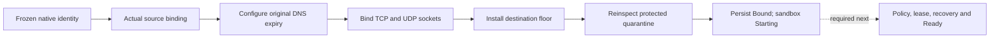

# Protected quarantine binding

The Rust Docker driver now composes the actual source floor, trusted DNS sockets and immutable destination floor under quarantine. It returns a fresh `ProtectedBindingReceipt` only after native readbacks. The private bootstrap persists the resulting `NetworkBinding` as Bound while the sandbox stays Starting. This is an intermediate provisioning checkpoint, not a policy lease, successful create operation or Ready publication. Full M0-M6 remains the objective.

`configure_dns` accepts a revision and fixed administrator-owned upstream. Its expiry comes from the original `NativeBridgePlan`, frozen after successful native binding in that controller process. A conflicting native replay or allocation is refused. Configuration cannot supply a new expiry or relative TTL. The server freezes its monotonic deadline before asynchronous native checks and refuses if that deadline expires during configuration. It accepts the full public 86400-second maximum, including positive subsecond remainders. The old private `enable_dns` fixture path retains its 1–1800-second bound and cannot produce an original-expiry receipt.

`listen_dns` binds paired TCP/UDP sockets on both owned gateways, commits a new deny-table revision, flushes prefilter queued traffic by closing the first sockets, and rebinds the exact protected tuples. The frontend keeps its bounded existing transport. Binding inspection requires all its listener tasks still running before and after native observations. This does not establish successful upstream resolution or permit workload DNS under quarantine.

The new readback checks the entire quarantine table: original owner and revision, exactly the expected filter hooks and priorities, empty ten-second live set, scoped neighbor infrastructure, both transports at each DNS tuple, exact source-interface dispatch and unconditional final denial. Unknown objects, additional rules, dormant flags, extra verdicts and nonempty lease sets refuse. Counter values and kernel handles may change; rule semantics and ordering may not. Inet table reads request numeric output. nftables still resolves meta-iif indices to interface names in JSON; only the frozen bridge name is normalized, with the actual bridge index checked before and after by the manager. JSON set timeout values are seconds.

Inspection also reobserves the complete Ethernet/source/destination guards, native gateway and port identity, exact DNS exemptions, revision and original expiry. The driver independently checks both Docker endpoint views, the provider gateway tuple and its pinned controller/native plan before mutation and after receipt. It compares destination intent, listener tuples and observation times, then requires a second fresh binding readback. Mutation failure, inconsistent confirmation or cancellation fences that session; EOF remains separate from process exit and collection. Duplicate protection is refused before mutation.

The private full bootstrap uses an owned zero-capability loopback DNS spy, configures an original one-hour sandbox expiry, and requires no upstream query, policy grant or user execution. It commits Bound without changing Starting and checks that the production worker later collects the exact container, controllers, bridge and all four table scopes. Initial composition at commit 2706704 passed on runc and gVisor: the [22-record hosted archive](evidence/m3-network-native-ci-45629055047-archive.json) verifies 157 immutable source files, both nine-group full and seven-group prepared-exit suites, the host quarantine gate and all retained packet regressions. This does not establish the subsequent controller-replacement recovery path.

The [prior source-only hosted archive](evidence/m3-network-native-ci-45620851883-archive.json) verifies all 21 passing records and 149 source hashes at commit 78d1af. Both runtimes passed full source bootstrap (eight groups), prepared exit before start (seven groups), and the retained packet suites. Those results establish the previous source-only increment, not this new DNS/destination composition.

The local [actual inet readback contract](evidence/m3-network-protected-binding-quarantine-readback-windows-docker.json) uses the Rust-generated plan on an owned Docker bridge and verifies the real kernel JSON with the same Rust verifier. A weakened guard snapshot is refused. Its [captured fixture](../crates/egress/tests/fixtures/quarantine-kernel-table.json) supports 22 portable mutation cases, numeric/resolved interface forms and authority-field rejection. Two earlier formatting-assumption failures are retained with Complete cleanup. This local kernel lacks bridge-family filtering; its composed bootstrap remains limited to the explicit unsupported-kernel refusal gate.

The subsequent [controller DNS recovery](dns-controller-recovery.md) restores exact destination-pinned DNS sockets under freshly verified quarantine and the original expiry. A policy/lease is not restored by that operation. The [effective-policy driver](effective-policy.md) separately applies and renews a fully read-back policy while its caller holds the session. The production worker continues terminal collection for owned-network journals, including [automatic native probes and pre-native cleanup](native-probes.md); worker session ownership, policy/recovery/Ready orchestration, credential isolation and the remaining M3-M6 work stay required. NetworkPolicy and SecretInjection are still unadvertised.
